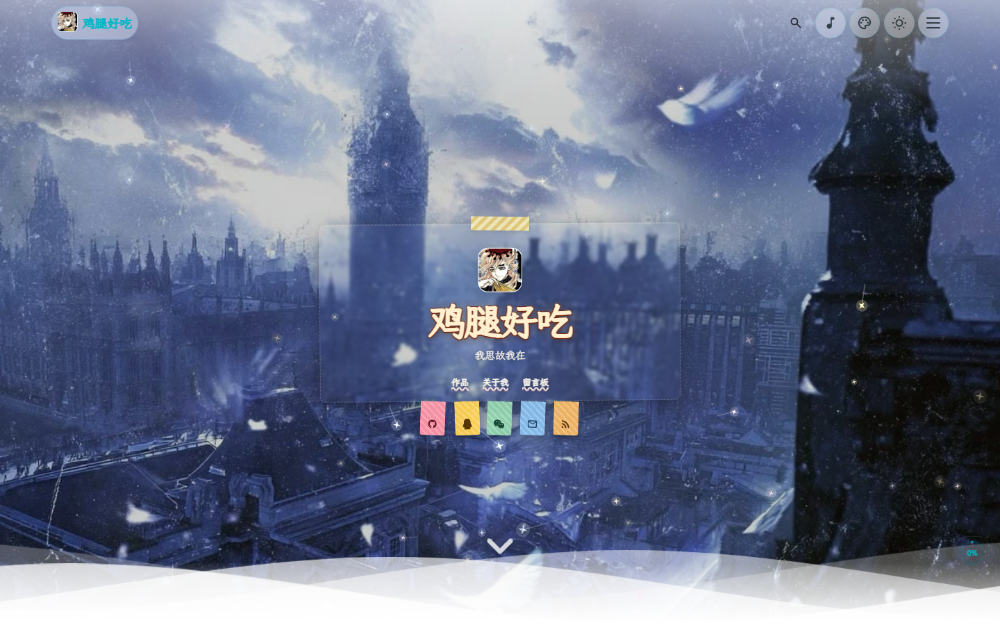
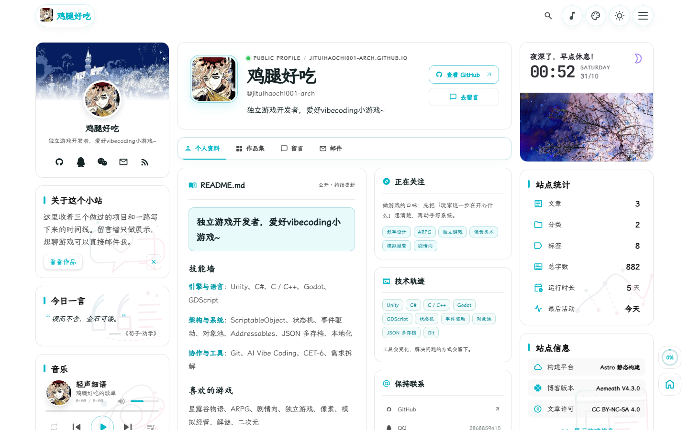

<div align="center">
  <h1>Jitui's Portfolio</h1>
  <p><strong>Indie game developer who loves vibecoding small games.</strong></p>
  <p>A personal portfolio, statically built with Astro and hosted on GitHub Pages.</p>
  <p>
    <a href="https://jituihaochi001-arch.github.io/">Live site</a> ·
    <a href="https://github.com/jituihaochi001-arch/jituihaochi001-arch.github.io">Repository</a> ·
    <a href="https://github.com/jituihaochi001-arch/jituihaochi001-arch.github.io/issues">Issues</a>
  </p>
  <p>
    <a href="https://astro.build/"></a>
    
    <a href="https://svelte.dev/"></a>
    
    
    
    
    <a href="LICENSE"></a>
  </p>
  <p><a href="README.md">简体中文</a> · <strong>English</strong></p>
</div>

<p align="center">
  <a href="#preview">Preview</a> ·
  <a href="#overview">Overview</a> ·
  <a href="#pages">Pages</a> ·
  <a href="#local-development">Local development</a> ·
  <a href="#deployment">Deployment</a> ·
  <a href="#content-and-config">Content and config</a> ·
  <a href="#project-layout">Project layout</a> ·
  <a href="#credits">Credits</a>
</p>

## Preview

### Home · wallpaper and profile card

A full-screen wallpaper with an avatar, name, one-line bio and social links; the rest of the page lists projects and notes.

<p align="center">
  <a href="https://jituihaochi001-arch.github.io/">
    
  </a>
</p>

### About · profile, skills and projects

A profile card and sidebar widgets on the left, the public README, skill wall, personal projects and a remix notice on the right.

<p align="center">
  <a href="https://jituihaochi001-arch.github.io/about/">
    
  </a>
</p>

> Screenshots come from the live site. Modules that need external services, such as comments, stay in an empty state until configured.

## Overview

This repository holds the full source of the portfolio. It collects the games and demos I have shipped, the tools I work with, and a way to reach me: the home page sets the tone, the archive lists projects over time, the about page details skills and personal work, and the guestbook is display-only.

Content lives in `src/content/` as Markdown and MDX and is turned into static pages at build time — no database, no runtime service. Comment integrations ship with the theme but stay unconfigured.

## Pages

| Page | Route | Content |
| --- | --- | --- |
| Home | `/` | Wallpaper, profile card, social links and site stats |
| Archive | `/archive/` | Projects and posts, filterable by category and tag |
| About | `/about/` | Profile, skill wall, personal projects and a remix notice |
| Guestbook | `/guestbook/` | Display-only message wall |
| Post | `/posts/<slug>/` | Markdown article with table of contents and sharing |
| Search | `/search/` | Full-text index generated by Pagefind |
| Feeds | `/rss.xml`, `/sitemap-index.xml`, `/robots.txt` | RSS, sitemap and crawler rules |

Navigation stays at four entries — Home, Works, About, Guestbook — defined in [`navBarConfig.ts`](src/config/navBarConfig.ts). Theme pages such as friends, gallery, bangumi and sponsor are disabled in the `pages` section of [`siteConfig.ts`](src/config/siteConfig.ts) and can be switched on individually.

## Local development

Requires **Node.js 22.12 or newer** and **pnpm 9**.

```sh
git clone https://github.com/jituihaochi001-arch/jituihaochi001-arch.github.io.git
cd jituihaochi001-arch.github.io
pnpm install
pnpm dev
```

The dev server runs at `http://localhost:4321` by default.

| Command | Purpose |
| --- | --- |
| `pnpm dev` | Start the dev server |
| `pnpm new-post <name>` | Create a post under `src/content/posts/` |
| `pnpm check` | Run Astro diagnostics |
| `pnpm type-check` | Run the TypeScript checker |
| `pnpm build` | Generate icons and placeholders, build the site, subset fonts and index it with Pagefind |
| `pnpm preview` | Preview the production build |

## Deployment

The build is fully static and published to GitHub Pages by GitHub Actions.

- Pushing to `main` triggers [`.github/workflows/deploy-pages.yml`](.github/workflows/deploy-pages.yml): install, build, upload the artifact, deploy. It can also be started manually from the Actions tab.
- [`actions/configure-pages`](https://github.com/actions/configure-pages) injects `PUBLIC_SITE_URL` and `BASE_PATH`; `astro.config.mjs` and `siteConfig.ts` consume them for canonical URLs, RSS and in-site asset links, so the domain never has to be hard-coded.
- The site must live at the root path: either name the repository `<user>.github.io` or attach a custom domain. Some in-site links are absolute to `/`, so deploying under `/<repo>/` would 404 — a guard step in the workflow fails early with that explanation.
- [`.github/workflows/build.yml`](.github/workflows/build.yml) (Build and Check) runs Astro checks and a build on push and pull requests.

## Content and config

Site settings live in `src/config/`:

| File | Purpose |
| --- | --- |
| [`siteConfig.ts`](src/config/siteConfig.ts) | Title, domain, language, start date, navbar style and page switches |
| [`profileConfig.ts`](src/config/profileConfig.ts) | Name, avatar, one-line bio and social links |
| [`navBarConfig.ts`](src/config/navBarConfig.ts) | Navigation labels, order and icons |
| [`backgroundWallpaper.ts`](src/config/backgroundWallpaper.ts) | Home wallpapers, background images and foreground decor |
| [`siteThemeConfig.ts`](src/config/siteThemeConfig.ts) | Default theme and theme switcher |
| [`effectsConfig.ts`](src/config/effectsConfig.ts) | Falling effect settings (stars, sakura, rain) |
| [`musicConfig.ts`](src/config/musicConfig.ts) | Sidebar playlist |
| [`commentConfig.ts`](src/config/commentConfig.ts) | Comment service, empty by default |

Page-level copy lives in `src/content/`:

| Content | Location |
| --- | --- |
| About page body (skills, favorite games) | [`src/content/spec/about.md`](src/content/spec/about.md) |
| About page remix notice | [`src/content/spec/about-open-source.md`](src/content/spec/about-open-source.md) |
| Guestbook entries | [`src/content/spec/guestbook.md`](src/content/spec/guestbook.md) |
| Posts and project notes | [`src/content/posts/`](src/content/posts/) |

Posts accept Markdown or MDX; frontmatter needs at least `title`, `published` and `description`, and may include `tags`, `category`, `image` and `draft`.

## Project layout

```text
src/
├── config/       Site, navigation, wallpaper, effects and theme settings
├── content/      Posts and standalone page content
├── components/   Astro and Svelte components
├── layouts/      Page layouts
├── pages/        Routes and static endpoints
├── styles/       Global and component styles
├── scripts/      Interaction scripts (click particles, falling effects)
├── plugins/      Markdown and build plugins
└── data/         Site data
public/           Static assets: avatar, wallpapers, fonts and icons
scripts/          Build and content helpers
docs/
├── images/       README screenshots
└── licenses/     Third-party licenses
.github/
└── workflows/    Checks and Pages deployment
```

## Credits

This site is not written from scratch. Its layout and components descend from [CuteLeaf / Firefly](https://github.com/CuteLeaf/Firefly) and [saicaca / Fuwari](https://github.com/saicaca/fuwari); the structure, components and most styles come from those authors — many thanks to them.

What I changed here:

- Copy and positioning: title, bio, navigation, about page and guestbook content
- Visual assets: avatar, home wallpaper and foreground decor
- About page: skill wall, personal project cards and a remix notice card
- Interaction details: star particles on click and while dragging
- Hosting: moved to static GitHub Pages instead of the theme author's own environment

Licensing:

- Theme code is under the [MIT License](LICENSE); third-party notices are in [`docs/licenses/`](docs/licenses/)
- Site text and images follow the CC BY-NC-SA 4.0 notice shown in the footer
- Character art, wallpapers and music remain the property of their respective owners — check their licenses before redistributing

If you build on this repository, please keep the upstream author and license notices.
