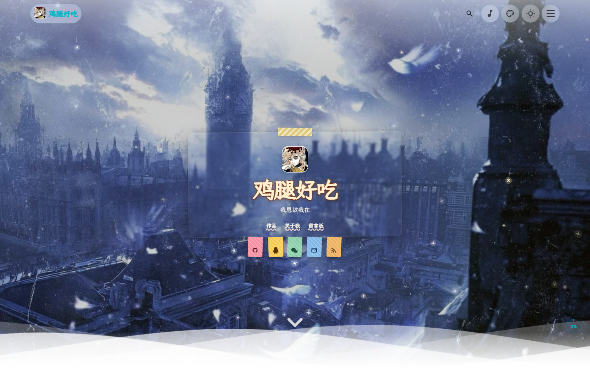
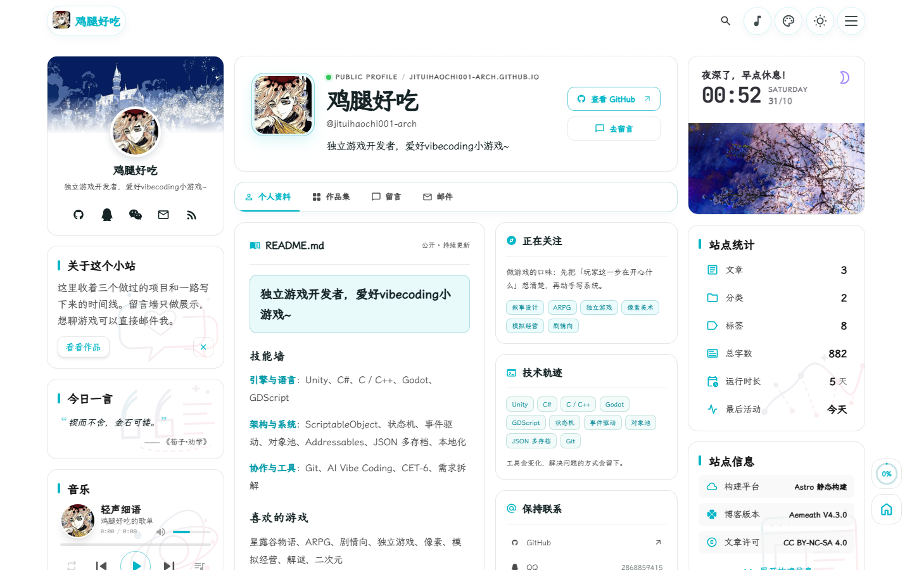

<div align="center">
  <h1>鸡腿的作品集</h1>
  <p><strong>独立游戏开发者，爱好 vibecoding 小游戏。</strong></p>
  <p>基于 Aemeath 主题二次创作的个人作品集，Astro 静态构建，托管在 GitHub Pages。</p>
  <p>
    <a href="https://jituihaochi001-arch.github.io/">访问站点</a> ·
    <a href="https://github.com/jituihaochi001-arch/jituihaochi001-arch.github.io">GitHub 仓库</a> ·
    <a href="https://github.com/jituihaochi001-arch/jituihaochi001-arch.github.io/issues">反馈问题</a>
  </p>
  <p>
    <a href="https://astro.build/"></a>
    
    <a href="https://svelte.dev/"></a>
    
    
    
    
    <a href="LICENSE"></a>
  </p>
  <p><strong>简体中文</strong> · <a href="README.en.md">English</a></p>
</div>

<p align="center">
  <a href="#站点预览">站点预览</a> ·
  <a href="#项目简介">项目简介</a> ·
  <a href="#页面一览">页面一览</a> ·
  <a href="#本地开发">本地开发</a> ·
  <a href="#部署">部署</a> ·
  <a href="#内容与配置">内容与配置</a> ·
  <a href="#仓库结构">仓库结构</a> ·
  <a href="#二次创作与致谢">二次创作与致谢</a>
</p>

## 站点预览

### 主页 · 壁纸与个人介绍卡

全屏壁纸打底，中间是头像、昵称、一句话简介和社交入口，往下是作品与随笔。

<p align="center">
  <a href="https://jituihaochi001-arch.github.io/">
    
  </a>
</p>

### 关于 · 个人资料与技能墙

左边是资料卡与侧栏组件，右边是公开的 README、技能墙、个人项目和二次创作声明。

<p align="center">
  <a href="https://jituihaochi001-arch.github.io/about/">
    
  </a>
</p>

> 截图取自线上站点。留言板等需要外部服务的模块在未配置时保留空状态。

## 项目简介

这个仓库放着作品集站点的全部源码。它用来记录做过的游戏与 Demo、整理技能栈、留一个能找到我的入口：首页负责第一眼，作品页按时间铺开项目，关于页写技能和个人项目，留言板只做展示，不开放提交。

内容用 Markdown / MDX 写在 `src/content/` 下，构建时生成静态页面，没有数据库和运行时服务。评论这类能力保留在主题里，默认不接入。

## 页面一览

| 页面 | 路由 | 内容 |
| --- | --- | --- |
| 主页 | `/` | 壁纸、个人介绍卡、社交入口与站点统计 |
| 作品 | `/archive/` | 项目与文章的归档列表，可按分类、标签筛选 |
| 关于 | `/about/` | 个人资料、技能墙、个人项目与二次创作声明 |
| 留言 | `/guestbook/` | 只做展示的留言墙 |
| 文章 | `/posts/<slug>/` | Markdown 正文、阅读目录、封面与分享 |
| 搜索 | `/search/` | Pagefind 生成的全文索引 |
| 订阅 | `/rss.xml`、`/sitemap-index.xml`、`/robots.txt` | RSS、站点地图与爬虫规则 |

导航固定为「主页 · 作品 · 关于 · 留言」四项，在 [`navBarConfig.ts`](src/config/navBarConfig.ts) 里维护。主题自带的友链、相册、番组计划、打赏等页面在 [`siteConfig.ts`](src/config/siteConfig.ts) 的 `pages` 中关闭，需要时可以单独打开。

## 本地开发

环境要求：**Node.js 22.12 或更高版本**、**pnpm 9**。

```sh
git clone https://github.com/jituihaochi001-arch/jituihaochi001-arch.github.io.git
cd jituihaochi001-arch.github.io
pnpm install
pnpm dev
```

开发服务器默认运行在 `http://localhost:4321`。

### 常用命令

| 命令 | 用途 |
| --- | --- |
| `pnpm dev` | 启动本地开发服务器 |
| `pnpm new-post <文件名>` | 在 `src/content/posts/` 下新建文章 |
| `pnpm check` | 运行 Astro 诊断 |
| `pnpm type-check` | 运行 TypeScript 检查 |
| `pnpm build` | 生成图标与图片占位、构建站点、裁剪字体子集并建立 Pagefind 索引 |
| `pnpm preview` | 预览构建产物 |

## 部署

站点是纯静态产物，由 GitHub Actions 发布到 GitHub Pages。

- 推送到 `main` 会触发 [`.github/workflows/deploy-pages.yml`](.github/workflows/deploy-pages.yml)：安装依赖 → 构建 → 上传产物 → 发布。也可以在 Actions 页面手动运行。
- [`actions/configure-pages`](https://github.com/actions/configure-pages) 会把站点地址与 base 注入 `PUBLIC_SITE_URL`、`BASE_PATH`，由 `astro.config.mjs` 和 `siteConfig.ts` 读取后写进 canonical、RSS 和站内资源链接，不用手改域名。
- 站点需要部署在根路径：仓库名要是 `<用户名>.github.io`，或者绑定自定义域名。主题有部分站内链接写死在根路径，放到 `/<仓库名>/` 子路径会 404，workflow 里有一步检查会直接报错说明原因。
- [`.github/workflows/build.yml`](.github/workflows/build.yml)（Build and Check）在 push 与 PR 时跑 Astro 检查和构建，用来拦住提交前的错误。

## 内容与配置

站点资料都在 `src/config/` 下，改完重新构建即可：

| 文件 | 用途 |
| --- | --- |
| [`siteConfig.ts`](src/config/siteConfig.ts) | 站点标题、域名、语言、建站日期、导航样式与页面开关 |
| [`profileConfig.ts`](src/config/profileConfig.ts) | 昵称、头像、一句话简介与社交链接 |
| [`navBarConfig.ts`](src/config/navBarConfig.ts) | 导航名称、顺序与图标 |
| [`backgroundWallpaper.ts`](src/config/backgroundWallpaper.ts) | 首页壁纸、背景图与前景装饰 |
| [`siteThemeConfig.ts`](src/config/siteThemeConfig.ts) | 默认主题与主题切换开关 |
| [`effectsConfig.ts`](src/config/effectsConfig.ts) | 飘落特效（星星 / 樱花 / 雨滴）参数 |
| [`musicConfig.ts`](src/config/musicConfig.ts) | 侧栏音乐列表 |
| [`commentConfig.ts`](src/config/commentConfig.ts) | 留言服务，默认留空 |

页面的独立内容放在 `src/content/`：

| 内容 | 位置 |
| --- | --- |
| 关于页正文（技能墙、喜欢的游戏） | [`src/content/spec/about.md`](src/content/spec/about.md) |
| 关于页的二次创作声明 | [`src/content/spec/about-open-source.md`](src/content/spec/about-open-source.md) |
| 留言墙内容 | [`src/content/spec/guestbook.md`](src/content/spec/guestbook.md) |
| 文章与项目记录 | [`src/content/posts/`](src/content/posts/) |

文章支持 Markdown 与 MDX，frontmatter 里至少有 `title`、`published`、`description`，还可以写 `tags`、`category`、`image` 与 `draft`。

## 仓库结构

```text
src/
├── config/       站点、导航、壁纸、特效与主题配置
├── content/      文章与独立页面内容
├── components/   Astro 与 Svelte 组件
├── layouts/      页面布局
├── pages/        页面路由与静态 API
├── styles/       全局与组件样式
├── scripts/      交互脚本（点击粒子、飘落特效等）
├── plugins/      Markdown 与构建插件
└── data/         站点数据
public/           静态资源：头像、壁纸、字体与图标
scripts/          构建与内容辅助工具
docs/
├── images/       README 预览截图
└── licenses/     第三方许可与版权说明
.github/
└── workflows/    构建检查与 Pages 部署
```

## 二次创作与致谢

这个站点不是从零写的。它基于 [Jarvis0227 / Aemeath](https://github.com/Jarvis0227/Aemeath) 二次创作，而 Aemeath 又脱胎于 [CuteLeaf / Firefly](https://github.com/CuteLeaf/Firefly) 与 [saicaca / Fuwari](https://github.com/saicaca/fuwari)。页面的结构、组件和大部分样式都来自这几位作者，这里一并致谢。

在本站里由我调整过的部分：

- 站点定位与文案：标题、简介、导航、关于页与留言板内容
- 视觉素材：头像、首页壁纸与前景装饰
- 关于页：技能墙、个人项目卡片与二次创作声明卡片
- 交互细节：点击与拖拽时出现的星星粒子
- 部署方式：改为 GitHub Pages 静态托管，不再依赖原主题的线上环境

许可约定：

- 主题代码遵循 [MIT License](LICENSE)，第三方许可见 [`docs/licenses/`](docs/licenses/)
- 站点图文按页脚标示的 CC BY-NC-SA 4.0 授权
- 角色插画、壁纸、音乐等素材的版权属于对应权利人，转载或再分发前请自行确认

如果也基于本仓库继续二次创作，请保留上游作者与许可声明。
